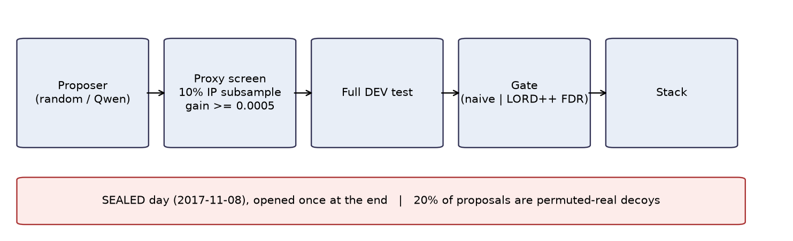
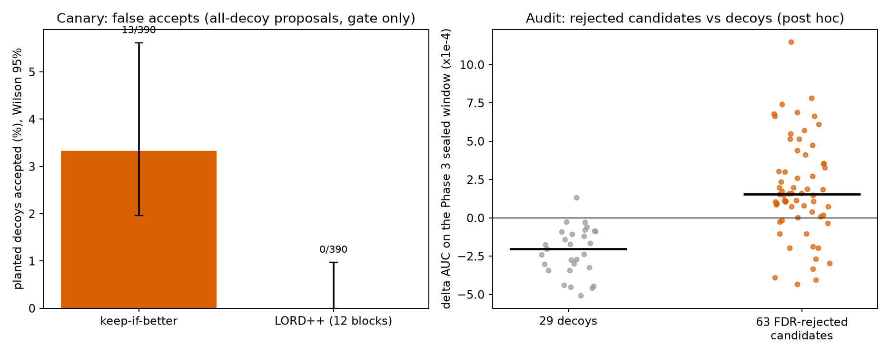
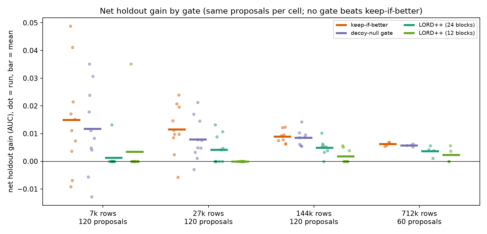
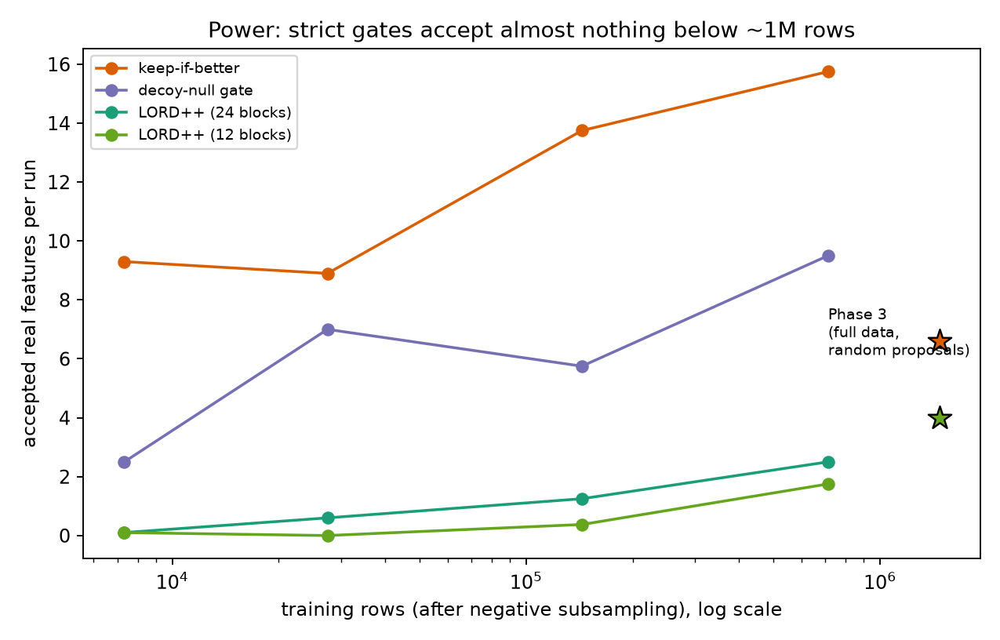

# AutoFeature Mini-Lab

**An evaluation-hygiene case study of agentic feature search.** When an agent proposes features and a gate decides what to keep, does the gate (and a sealed holdout day) matter more than the proposer? Pre-registered hypotheses, a sealed day opened once, planted decoys as canaries, TalkingData AdTracking, CPU-scale compute.

## TL;DR

1. **Phase 3 (pre-registered):** the sealed day confirmed DEV almost exactly. The naive keep-if-better gate did not overfit; random proposals matched or beat Qwen 3B/7B/14B under a fixed grammar. H1, H2 and H3 all failed their own rules.
2. **Both sides of the gate were measured.** Keep-if-better accepted 13 of 390 planted decoys (3.3%; one phantom feature in every one of 13 canary runs); LORD++ accepted 0 of 390. But 78% of the 63 candidates LORD++ rejected had a positive sealed delta, against 3% of decoys.
3. **Regime map (Phases 5, 5b):** from 7k to 712k training rows, no gate we tried beats keep-if-better on net holdout gain. Strict online-FDR gates starve (even with 24 blocks and the gate alive); a decoy-calibrated gate ties keep-if-better at 144k and 712k rows with about 2.7x fewer accepted decoys.
4. **The random-vs-LLM gap traces to one rare feature** that one random run happened to propose. The grammar census shows it is a lucky draw, not LLM inferiority.

This is a descriptive case study, not a method paper. Read the limits first.

## Read this first: scope and limits

- One dataset (TalkingData), one fixed grammar that contains the good operations (selection, not invention), one DEV/SEALED day pair.
- Phases 5 and 5b use a random proposer and a holdout day (2017-11-08) that Phase 3 had already used for its verdicts: not a fresh holdout. 2017-11-07 stays unopened.
- 5-10 runs per cell (4 in the 712k-row cell). Eight gate-vs-naive contrasts in Phase 5b are not corrected for multiplicity; the optimism result at 144k rows is one of them.
- "Tied" is not "equivalent": no equivalence margin was pre-registered.
- No novelty is claimed on online FDR, decoy/knockoff-style nulls, or reusable holdouts (see Related work). The contribution is a controlled empirical calibration in an agentic setting.
- Qwen2.5 family only. Contamination probes named other datasets (weak evidence of low contamination).
- Decoy checks on SEALED use the 29 gate-tested decoys of Phase 3; the audit reference class is therefore small.

## Design (Phase 3)

- **Data:** DEV = 2017-11-09 08:00-16:00 (25.7M rows); SEALED = 2017-11-08, same hours, opened once, at the end. Baseline (4 raw ID columns) and human ceiling: DEV 0.97040 / 0.98471, SEALED 0.97421 / 0.98544.
- **Grammar:** 6 operations (count, nunique, cumcount, lag, roll, ratio) over keys c0-c4 and h.
- **Pipeline:** proxy screen (10% IP subsample, gain >= 0.0005) -> full DEV test -> gate -> stack. 20% of proposals are permuted-real decoys.
- **Gates:** naive (keep if DEV AUC rises) vs LORD++ (alpha 0.10, sign-flip p over 12 blocks, materiality floor 0.000219).
- **Arms (5 runs x 60 proposals):** random + FDR, random + naive, Qwen 7B + FDR / naive, Qwen 3B + FDR, Qwen 14B + FDR.
- **Metric:** gap closed (%) = (AUC - baseline) / (ceiling - baseline); optimism = DEV gap closed minus SEALED gap closed.
- **Hypotheses (frozen before any SEALED result):** H1 the naive gate shows a larger optimism gap; H2 LLM proposals close more of the SEALED gap than random; H3 proposer size matters less than the gate. Descriptive statistics only; exact permutation p = 1/252 is allowed only if all 5 runs of one arm beat all 5 of another.

## Results: Phase 3 (SEALED opened once)

| Arm | SEALED gap closed, mean (median) | Range | DEV mean | Optimism | Effective outcomes |
|---|---|---|---|---|---|
| Random + FDR | 56.6 (48.1) | 42.8-93.3 | 55.6 | -1.0 | 5 |
| Random + naive | 55.3 (47.8) | 39.1-90.5 | 56.4 | +1.0 | 5 |
| Qwen 7B + FDR | 32.9 (31.3) | 26.5-45.1 | 37.1 | +4.2 | 5 |
| Qwen 7B + naive | 45.1 (43.7) | 32.4-56.7 | 40.3 | -4.8 | 5 |
| Qwen 3B + FDR | 34.7 (35.4) | 31.9-35.4 | 29.2 | -5.5 | 2 |
| Qwen 14B + FDR | 40.1 (39.8) | 39.5-40.8 | 37.6 | -2.5 | 5 |

Negative optimism = SEALED did better than DEV. Source: `results/phase3/`.

**Verdicts (pre-registered rules)**
- **H1 not supported:** the naive gate showed no larger optimism gap (random -1.0 vs +1.0; 7B naive is better on SEALED, -4.8 vs +4.2). Rule outcome: *the gate was not needed on this task.*
- **H2 not supported:** random beats the LLM on means; 7B + naive is close to random on medians. Rule outcome: *grammar + gate carry the result; the LLM adds little here.* R and R-naive share the proposer seed, so their high run 3 is one lucky draw shown twice.
- **H3 not supported by the rule, near tie:** size effect 7.2 points vs gate effect 6.7; 3B is effectively two outcomes.
- No exact-permutation claim is available (ranges overlap in every valid pair).

**Post hoc decoy check (Phase 3 sealed window):** 28 of 29 re-permuted decoys lowered SEALED AUC (mean delta -0.000219); 0 of 29 passed the materiality floor. LORD++ was not re-simulated (trial-level state not embedded).




## Exploratory (post hoc): the "needle"

Random's high SEALED runs trace to one feature, `lag(c0, c1, c3; k=1, dir=next)` (gain +0.0066 when accepted). It was proposed in 1 of 5 random runs (same draw in R and R-naive) and by none of the 15 Qwen runs. Without that run, random and 7B + naive are equal (about 47-48% SEALED gap closed).

**The grammar census (Phase 4b, DEV, descriptive) says this is luck.** The feature ranks 2nd of 796 non-ratio specs by single-feature proxy gain, but the random sampler proposes it with probability 5.6e-4 per proposal: about 0.13 expected hits in the 240 distinct random draws (P(at least one) is about 12%), and about 0.5 expected hits had the 960 LLM proposals been drawn like random ones. Not proposing it is unremarkable. The LLMs did explore the lag region (the two 7B arms proposed 85 lags, 78 of them `next`), just never that key set.

## Phase 4b: both errors of the gate (CPU, pre-registered rules, `docs/PHASE4B_PLAN.md`)

| Test | Result |
|---|---|
| **Canary (gate only, proxy bypassed; 13 runs x 30 decoys per gate, paired decoys)** | Keep-if-better accepted **13 / 390** (3.3%, Wilson 2.0-5.6%); LORD++ accepted **0 / 390** (upper bound 1.0%). Fisher p = 0.0001; naive accepted noise while FDR did not in 13 of 13 paired runs. Accepted noise "closed" about 2% of the DEV gap. |
| **Audit of FDR-rejected candidates (63 material DEV candidates scored on the Phase 3 sealed window; post hoc)** | 78% had a positive sealed delta vs 3% of the 29 decoys; 81% beat the decoy 95th percentile; P(candidate > decoy) = 0.89. By arm: 7B 12/12 positive, 3B 4/4, 14B 24/33, random 9/14 (2 material). Rule outcome: *the gate discarded real signal.* |
| **Grammar census (descriptive)** | 88% of non-ratio specs and 83% of sampled ratio specs add proxy gain on their own (single-feature gain over the raw baseline, not marginal gain given a stack): the grammar is saturated with weakly useful features, which is why random is a strong baseline. |

A phantom feature costs about -0.0002 AUC on the sealed window (decoy median), a rejected real feature adds about +0.00016 (median). Keep-if-better wins as long as true accepts outnumber phantom accepts.



## Phases 5 and 5b: when does a gate pay off? (`docs/PHASE5_PLAN.md`, `docs/PHASE5B_PLAN.md`)

Random proposals from the Phase 3 grammar, identical sequence under every gate (paired), no proxy screen; training size varied by IP subsample; optimism = DEV gain (3 fresh seeds) minus the holdout gain of the same final stack; holdout 2017-11-08.

**Phase 5: keep-if-better vs LORD++ (12 blocks)**

| Training rows | Proposals | Naive optimism [95% CI] | Naive holdout gain | LORD++ holdout gain | LORD++ real accepts per run | LORD++ tests dead |
|---|---|---|---|---|---|---|
| 7k | 120 | +0.0207 [0.0045, 0.0375] | 0.0150 | 0.0035 | 0.1 | 93% |
| 27k | 30 / 120 | +0.0062 / +0.0052 | 0.0052 / 0.0115 | 0 / 0 | 0 / 0 | 77% / 94% |
| 144k | 30 / 120 | +0.0009 / +0.0025 | 0.0074 / 0.0089 | 0 / 0.0018 | 0 / 0.4 | 77% / 91% |
| 712k | 60 | +0.0012 [0.0008, 0.0015] | 0.0063 | 0.0023 | 1.75 | 45% |

H5-1 (naive's excess optimism grows as n shrinks) is supported by the rule (Spearman -0.97), but trivially: LORD++ accepts almost nothing, so its optimism is about 0. H5-2 (LORD++ has the higher net holdout gain at the smallest n) fails in every cell: naive minus LORD++ holdout gain is positive with a 95% CI excluding 0 in all six cells.

**Phase 5b: do better gates pay off?** (24-block exact LORD++, and a decoy-null gate that accepts a candidate whose gain is in the top 5% of a rolling null of the last 40 decoy gains, after a 20-decoy warm-up). Naive replication matches Phase 5 exactly (max difference 0.000000 over 20 pairs).

| Training rows | keep-if-better | decoy-null gate (vs naive, 95% CI) | LORD++ 24 blocks | LORD++ 12 blocks |
|---|---|---|---|---|
| 7k | 0.0150 | 0.0117 (-0.0033 [-0.0099, 0.0040]) | 0.0013 | 0.0035 |
| 27k | 0.0115 | 0.0079 (-0.0036 [-0.0060, -0.0013]) | 0.0042 | 0 |
| 144k | 0.0089 | 0.0086 (-0.0004 [-0.0017, 0.0017]) | 0.0049 | 0.0018 |
| 712k (60 proposals) | 0.0063 | 0.0058 (-0.0005 [-0.0010, 0.0001]) | 0.0037 | 0.0023 |

Primary pre-registered rule (a gate wins if the paired CI of net holdout gain vs naive has a lower bound above 0 in any cell): **no gate wins.** Planted decoys accepted across the four cells (720 tested per gate): keep-if-better 43 (6.0%), decoy-null gate 16 (2.2%), both LORD++ variants 0 (upper bound 0.53%). The 24-block gate was never dead (alpha_t never below its floor) yet still accepted only 0.1-2.5 real features per run, against 9-16 for naive: the starvation is intrinsic to alpha-investing at this evidence level, not only to a low p-value floor.




## What this adds (and what it does not)

- **Adds:** the two error types of a gate measured in one pipeline with planted nulls (keep-if-better passes about 3% of noise per test; strict gates reject real signal and starve below about 700k rows); a quantitative regime map; a decoy-calibrated gate that ties keep-if-better at 144k+ rows with fewer false accepts; a fully pre-registered, sealed-day protocol whose nulls were reported as such.
- **Does not claim:** novelty on online FDR or decoy/knockoff nulls; any statement about LLM versus random beyond this fixed grammar; generalization beyond this dataset; that keep-if-better is optimal (below about 1M rows it is simply hard to beat here).
- **Answer to the original question** ("does the harness matter more than the proposer?"): on this task, not by much. The sealed day mostly confirmed DEV, strict gates cost more than they saved at the sizes tested, and proposer differences reduced to one rare feature found once.

## Related work (verify citations before any submission)

Online FDR and alpha-investing (Foster and Stine; Javanmard and Montanari; Ramdas et al., LORD++); reusable holdout and Ladder (Dwork et al.; Blum and Hardt); shadow/decoy features and knockoffs (Boruta; Barber and Candes); LLM-driven feature engineering (e.g. LLM-FE, SymboLLM-FE), which rely on validation-set feedback. I read only abstracts for the last group; the claim that they lack false-discovery control is an open question, not a finding. A Thresholdout baseline is the obvious missing comparison.

## Phase 4 (pilots only)

Phase 4 (rung 1-2 grammars, GPU arms, fresh sealed day) was closed early; see `docs/PHASE4_PLAN.md`. Its random runs (rung 1: 31.5% DEV gap closed; rung 2: 35.0%) and a canary pilot are exploratory; the headline hypothesis H4-1 was not tested.

## Provenance (UTC)

Spec and DEV results committed (`619cd08`, tag `phase0-freeze-v2`) before the Kaggle SEALED job started on 2026-11-19 22:25; the runner script was committed 10-16 minutes after the job started (`e3ff20f`, `3e0bac9`) and its sha256 (`c5d8e730...`) is recorded in `results/phase3/phase3_lock.json`; the job finished 2026-11-20 02:09 (tag `phase3-sealed`). An earlier invocation crashed on a parsing bug before any feature AUC was computed on SEALED, and an earlier skeleton wrote a `started` lock that was archived. No SEALED feature result was read before the final run. Plans for Phases 4b, 5 and 5b were frozen and tagged before their runs (`phase4b-freeze`, `phase5-freeze`, `phase5b-freeze`); Phase 5, 5b and the audit reuse the Phase 3 sealed day as a holdout and say so.

## Reproduce

Everything runs on Kaggle CPU (Phases 3, 4b, 5, 5b); the LLM arms of Phases 1-2 need a GPU with a local Qwen server. See `RUN_ORDER.md` and `docs/REPO_MAP.md`.

```bash
kaggle kernels push -p kaggle/phase3                 # Phase 3: the one-shot sealed run
bash scripts/p4b_prepare.sh && bash scripts/p4b_push.sh      # Phase 4b notebooks
bash scripts/p5_prepare.sh  && bash scripts/p5_run.sh push   # Phase 5 regime map
bash scripts/p5b_prepare.sh && bash scripts/p5b_run.sh push  # Phase 5b gates
python3 code/af_phase3_analyze.py                    # Phase 3 figures + diagnostics
python3 code/af_final_figures.py                     # final figures from existing results
```

Layout: `code/` pipeline, `kaggle/` notebooks, `scripts/` shell tooling, `results/` all outputs (`results/INDEX.md`), `figures/`, `docs/` plans frozen before runs, `archive/` aborted attempts. Git tags: `phase0-freeze-v2`, `phase3-sealed`, `phase4b-freeze`, `phase5-freeze`, `phase5-results`, `phase5b-freeze`, `phase5b-results`. Default branch: `master`.
